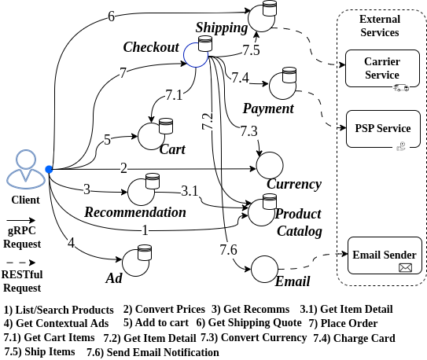
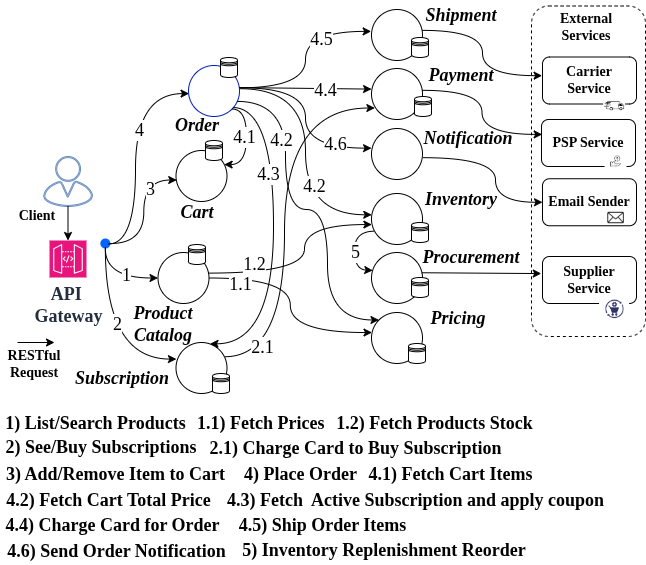
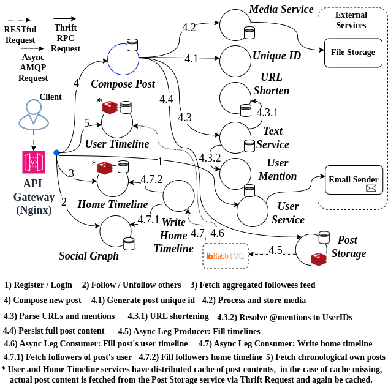

# Hybrid service-agent architecture multi-objective optimization

## Microservice System Benchmarks:


- **[*Google Online Boutique Microservices (B1)](https://github.com/GoogleCloudPlatform/microservices-demo)** (ms_baseline/google_ms)
  
   

- Original source code: https://github.com/GoogleCloudPlatform/microservices-demo
  
- Python-converted source code with gRPC and MongoDB integration: (ms_baseline/google_ms folder)
  
------------------

- **RetailBen (B2)** (Own Designed)
  
  

- Original source code: ms_baseline/retailben folder

-------------------


- **[DeathStarBench Social Network (B3)](https://github.com/delimitrou/DeathStarBench/tree/master/socialNetwork)** (ms_baseline/dsb_social)
  
   

- Original source code: https://github.com/delimitrou/DeathStarBench/tree/master/socialNetwork
  
- Python-converted source code with thrift same MongoDB / Redis integration: (ms_baseline/dsb_social folder)   

----------------------------


## AI Agents Implementation:

All AI agents are implemented using Python, Langgraph framework, and communicating via Ollama server via API (local in our setup but can modified to a remote server) to use open sources LLMs, while can also use major AI vendors by API key (e.g., gemini, claude, openAI).

For each microservice in each benchmark, an equivalent AI agent is implemented with the same database technology, DDD entities, communication interface (e.g., RESTful APIs, gRPC or thrift) are used for agents, and only the static functionality and logic of services converted as dynamic reasoning. Hence, the AI agents are pluggable in the system, so each component in the benchmarks can deployed either as service or AI agent.

- **RetailBen** (refactored_architecture/retailben)
- **Google Online Boutique Microservices** (refactored_architecture/google_ms)
- **DeathStarBench Social Network** (refactored_architecture/google_ms) 

----------------------------

# Prerequisite

## Run Ollama server (locally / remote server) 
### (Needs a GPU node with at least 48GB of memory)

The ollama server should be installed first, then ready to be started (with inference optimization) and pull open sourced models:

```bash
    # configuration for inference optimization (required for maximum throughput and memory usage efficiency)
    setenv OLLAMA_FLASH_ATTENTION 1 # Enables Flash Attention on modern GPUs
    setenv OLLAMA_KV_CACHE_TYPE q4_0 # Compresses the KV cache with lower quantization
    setenv OLLAMA_KEEP_ALIVE 2h # keeps the model for 2h, eliminating "cold start" for subsequent requests.
    setenv OLLAMA_NUM_PARALLEL 100 # Defines how many simultaneous requests a single model will process.

    # start server
    systemctl start ollama
    ollama pull llama3.2:3b
    ollama pull llama3:8b
    ollama pull qwen3:14b

    # warm up (load the model in memory)
    ollama run llama3.2:3b "Explain CAP theorem in 3 sentences."
    ollama run llama3:8b "Explain CAP theorem in 3 sentences."
    ollama run qwen3:14b "Explain CAP theorem in 3 sentences."
```

## Run local dockerized database and message broker

- MongoDB: 
    ``` bash
    docker compose up -d mongodb
    ```

- Redis: 
    ``` bash
    docker compose up -d redis
    ```

- RabbitMQ: 
    ``` bash
    docker compose up -d rabbitmq
    ```

**Check default user/password/db_name that set here in codes respectively, thereafter.**

----------------------------


# Deploy architectures (Microservice or Hybrid with agents) and Run Experiments

There is a **deploy-local.sh** script in the deploy_orchestration folder for each benchmark, which receives the list of service (with ports) and agents to deploy each component as service or AI agent.  


# Deployment of microservice baseline and gather its metrics

1-  **Google Online Boutique Microservices**

```bash
    cd deploy_orchestration/google_ms
    
    ./deploy-local.sh services=ad_service:5057,cart_service:5054,checkout_service:5050,currency_service:5053,email_service:5056,payment_service:5052,product_catalog_service:5055,recommendation_service:5058,shipping_service:5051 agents=

    # 2. Evaluate with workload and gather metrics
    python3 -m ms_baseline.google_ms.exp_runner
    
    # the full evaluation results will be gathered in ms_baseline/google_ms/results folder.
```

2-  **RetailBen**

```bash
    # 1. Deploy locally

    cd deploy_orchestration/retailben
    
    ./deploy-local.sh services=payment_service:8007,inventory_service:8001,shipment_service:8006,shopping_cart_service:8003,pricing_service:8002,product_search_service:8008,procurement_service:8009,order_service:8000,subscription_service:8010,notification_service:8011 agents=

    # 2. Evaluate with workload and gather metrics
    cd ms_baseline/retailben
    python3 exp_runner.py

    # the full evaluation results will be gathered in ms_baseline/retailben/results folder.
```

3-  **DSB-Social-Network**

```bash
    cd deploy_orchestration/dsb_social
    
    ./deploy-local.sh services=compose_post_service:9100,home_timeline_service:9099,media_service:9091 post_storage_service:9096,social_graph_service:9097,text_service:9095,unique_id_service:9090,url_shorten_service:9092,user_mention_service:9093,user_service:9094,user_timeline_service:9098,write_home_timeline_service:8999 agents=

    # 2. Evaluate with workload and gather metrics
    python3 -m ms_baseline.dsb_social.exp_runner --trials 5000 --concurrency 20
    
    # the full evaluation results will be gathered in ms_baseline/dsb_social/results folder.
```


-----------------------------


# Create cross-strategy architecture candidate pool (gather results of different agentification strategies)

### 1. Fixed hybrid architecture proposals (orchestrator, non-orchestrator, user-interacting agentification methods):

For each strategy, the resulting target final architecture should be deployed (using **deploy-local.sh** script which allows deploy any component as service or agent, commands are available separately for each strategy). Also the model and temperature can be selected for different runtime conditions.

The experiment runner script (available for each benchmark in its folder in refactored_architecture folder as **exp_runner.py**) should be executed on the deployed architecture with a workload with total requests (trials) and concurrency level to find the quality, latency, failure deviation, to obtain the QA / latency deviations.


### 2. Complexity-ranked predicate-driven iterative refactoring 


Should change the acceptance thresholds for QA (epsilon_qa) and latency deviation (epsilon_l) based on grid search in **run_complexity_ranked_iterative_full_migration_cycle.py** script for each benchmark available in deploy_orchestration folder, to run full migration cycle with given thresholds pair and obtain the final architecture and its deviation for each thresholds pair.

The script itself loops over various runtime conditions for model setting and concurrency levels, and runs the experiment runner with desired concurrency level and workload requests for both intermediate regression analysis and final architecture evaluation.

--------------------------


# Run Multi-objective architecture optimization

### 1. Plot architecture candidate pool trade-off space
The full results obtained from previous step (cross-strategy architecture candidate pool) should be aggregated for all 4 strategies across all 8 runtime conditions in a json file.
The current architecture candidate pool result is available at figures/results/agentification_strategy_arch_pool_tradeoffs_experiment_data.json

To plot the scatter plots for each benchmark and runtime condition to demonstrate trade-space between latency inflation, quality deviation, and agentification coverage:

```bash

cd figures

python3 plot_cross_agentification_strategy_arch_pool.py

```

The resulting figure is generated in generated_figs/agentification_strategy_arch_pool_tradeoffs.png

### 2. Perform and plot three-objective Pareto analysis with exhaustive Pareto filtering 


- Exact Pareto filtering on architecture candidate pool results to only obtain Pareto frontier
```bash

cd figures

python3 architecture_opt_pareto_filter.py --input results/agentification_strategy_arch_pool_tradeoffs_experiment_data.json

```

- Exact Pareto filtering on architecture candidate pool results to obtain and plot Pareto frontier
```bash

cd figures

python3 architecture_opt_pareto_filter_plot.py --input results/agentification_strategy_arch_pool_tradeoffs_experiment_data.json

```

- Calculate comparisons of strategies contribution to the Pareto frontier
  
```bash
cd figures

cd pareto_output && python3 calculate_agentification_strategies_metrics.py --raw ../results/agentification_strategy_arch_pool_tradeoffs_experiment_data.json --pareto pareto_fronts.json --outdir table_iii_output

```

### 3. Perform and compare results of alternative optimization methods with Pareto analysis

- Obtain results of alternative optimization methods 
  
```bash
cd figures

python3 architecture_opt_alternative.py \
    --raw results/agentification_strategy_arch_pool_tradeoffs_experiment_data.json \
    --pareto pareto_output/pareto_fronts.json \
    --outdir alternative_optimization_output \
    --weight-step 0.1 \
    --delta-l 1.0 \
    --delta-qa 0.1 \
    --slo-epsilon 2.0 \
    --ignore-slo-constraint

```

- Calculate comparisons of alternative optimization with the Pareto frontier
  
```bash
cd figures

cd alternative_optimization_output && python3 calculate_alternative_opt_metrics.py \
    --raw ../results/agentification_strategy_arch_pool_tradeoffs_experiment_data.json \
    --pareto ../pareto_output/pareto_fronts.json \
    --lex lexicographic_selections.csv \
    --weighted weighted_sum_selections.csv \
    --outdir table_iv_output

```
